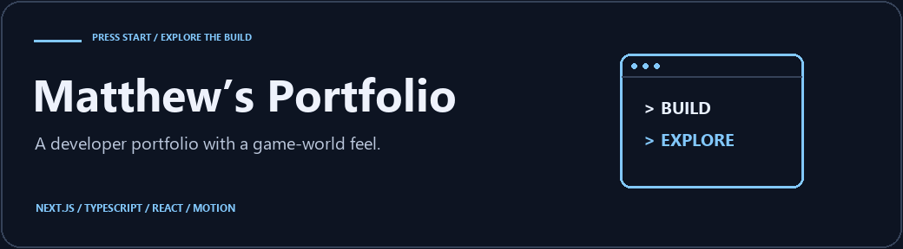
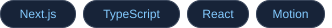

<div align="center">



# Matthew’s Portfolio

**A developer portfolio with a game-world feel.**



[Overview](#overview) &nbsp; · &nbsp; [Run locally](#run-locally) &nbsp; · &nbsp; [Explore the repository](https://github.com/mcampo0215/MyWebsite)

</div>

---

## Overview

An interactive personal portfolio built around a game-inspired interface. Visitors move from an animated intro into achievements, a player build, and project arenas, with project detail views and character-inspired visuals.

| Press start | Explore | Inspect |
| :--- | :--- | :--- |
| Enter through the animated intro and flip-card transition. | Browse achievements, coursework, skills, and project arenas. | Open project details and follow the portfolio’s visual progress indicators. |

## Run locally

Install Node.js and npm, then:

```sh
npm ci
npm run dev
```

Open `http://localhost:3000`. The development script explicitly uses Next.js with Webpack.

## Make it your own

| Source | Responsibility |
| :--- | :--- |
| [src/app/page.tsx](src/app/page.tsx) | Intro transitions, tab state, and project modal state. |
| [src/components/portfolio/data.ts](src/components/portfolio/data.ts) | About text, coursework, project descriptions, and display metrics. |
| [src/components/portfolio/PortfolioView.tsx](src/components/portfolio/PortfolioView.tsx) | Main portfolio shell. |
| [src/components/portfolio/ProjectsSection.tsx](src/components/portfolio/ProjectsSection.tsx) | Project arenas. |
| [src/components/portfolio/ProjectModal.tsx](src/components/portfolio/ProjectModal.tsx) | Expanded project view. |
| [src/app/globals.css](src/app/globals.css) | Global visual styling. |

The current level is derived from the number of listed projects. Completion and skill-style indicators are authored display values in the project data, not automated measurements.

## Development

```sh
npm run lint
npm run build
npm start
```

The portfolio is driven by local content and components; no separate backend is required for the current site.

---

<p align="center"><a href="#matthews-portfolio">Back to the top</a></p>
